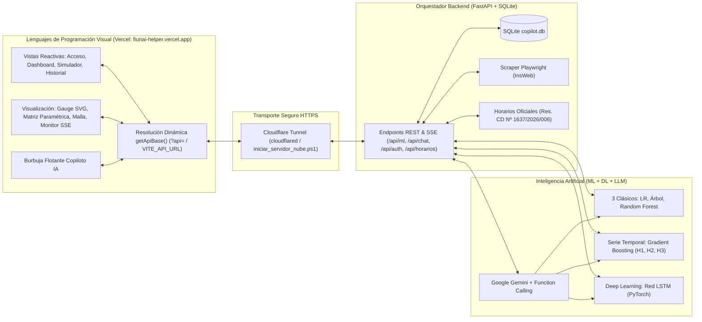

# 📘 Guía de Inducción Académica y Técnica: Inteligencia Artificial & Lenguajes de Programación Visual

> **Proyecto Integrador:** Copiloto Académico FIUNA — Plataforma Inteligente de Acompañamiento y Predicción  
> **Institución:** Facultad de Ingeniería — Universidad Nacional de Asunción (**FIUNA**, Ingeniería Mecatrónica, 2C 2026)  
> **Asignaturas Integradas:** **Inteligencia Artificial** (Cód. 5738) y **Lenguajes de Programación Visual** (Cód. 5728)

Este documento cumple un rol complementario al [README.md](./README.md): mientras el `README.md` explica cómo instalar y ejecutar la plataforma paso a paso, esta guía detalla **por separado las implicaciones teóricas y las aplicaciones prácticas concretas** de los contenidos de **Inteligencia Artificial** y de **Lenguajes de Programación Visual** dentro del proyecto.

---

## 📌 Tabla de Contenidos

1. [Visión General del Proyecto Integrador](#1-visión-general-del-proyecto-integrador)
2. [Parte I — Inteligencia Artificial (Cód. 5738): Implicaciones y Aplicaciones](#2-parte-i--inteligencia-artificial-cód-5738-implicaciones-y-aplicaciones)
   - [2.1. Preprocesamiento, Limpieza y Prevención de Data Leakage](#21-preprocesamiento-limpieza-y-prevención-de-data-leakage)
   - [2.2. Machine Learning Supervisado Clásico y Desbalance de Clases](#22-machine-learning-supervisado-clásico-y-desbalance-de-clases)
   - [2.3. Series Temporales y Predicción Progresiva Multi-Hito](#23-series-temporales-y-predicción-progresiva-multi-hito)
   - [2.4. Deep Learning Secuencial: Red Neuronal Recurrente LSTM](#24-deep-learning-secuencial-red-neuronal-recurrente-lstm)
   - [2.5. Reentrenamiento Dinámico por Asignatura y Muestras Pequeñas](#25-reentrenamiento-dinámico-por-asignatura-y-muestras-pequeñas)
   - [2.6. LLMs, Contexto Persistente y Agentes con Function Calling](#26-llms-contexto-persistente-y-agentes-con-function-calling)
   - [2.7. Despliegue de Modelos, Infraestructura Híbrida e Inferencia vía API](#27-despliegue-de-modelos-infraestructura-híbrida-e-inferencia-vía-api)
3. [Parte II — Lenguajes de Programación Visual (Cód. 5728): Implicaciones y Aplicaciones](#3-parte-ii--lenguajes-de-programación-visual-cód-5728-implicaciones-y-aplicaciones)
   - [3.1. Programación Orientada a Eventos y Reactividad Declarativa](#31-programación-orientada-a-eventos-y-reactividad-declarativa)
   - [3.2. Arquitectura Basada en Componentes Reutilizables y Tipado Estricto](#32-arquitectura-basada-en-componentes-reutilizables-y-tipado-estricto)
   - [3.3. Visualización de Datos, Dashboards y Controles Interactivos](#33-visualización-de-datos-dashboards-y-controles-interactivos)
   - [3.4. Telemetría en Tiempo Real (Streaming SSE) y Retroalimentación Visual](#34-telemetría-en-tiempo-real-streaming-sse-y-retroalimentación-visual)
   - [3.5. Diseño Responsivo, Temas Visuales y Experiencia de Usuario (UX)](#35-diseño-responsivo-temas-visuales-y-experiencia-de-usuario-ux)
   - [3.6. Integración de la Interfaz con Servicios Externos y Persistencia](#36-integración-de-la-interfaz-con-servicios-externos-y-persistencia)
4. [Mapa Cruzado de Módulos por Asignatura](#4-mapa-cruzado-de-módulos-por-asignatura)

---

## 1. Visión General del Proyecto Integrador

El **Copiloto Académico FIUNA** aborda un problema real de ingeniería y gestión estudiantil: la alta tasa de recursamiento en asignaturas filtro y la falta de herramientas visuales predictivas que permitan al estudiante anticipar su riesgo académico *durante* el semestre.

---

## 2. Parte I — Inteligencia Artificial (Cód. 5738): Implicaciones y Aplicaciones

En esta materia el foco está en el **modelado matemático, el entrenamiento riguroso sin fuga de datos, la evaluación comparativa de algoritmos y la orquestación de agentes inteligentes**.

### 2.1. Preprocesamiento, Limpieza y Prevención de Data Leakage

- **Implicación teórica:**  
  Un modelo entrenado con datos duplicados, valores nulos o variables mal consolidadas produce métricas artificialmente infladas (*data leakage* entre `Train` y `Test`) que fallan al generalizar con alumnos nuevos.
- **Aplicación en el proyecto (`backend/services/ml/trainer.py`, `dataset_fiuna_compact.csv`):**
  - El dataset histórico original (`datos_concatenados.csv`, 64,295 registros de FIUNA) contiene filas duplicadas donde solo cambia el identificador anonimizado `ALUMNO_ID`.
  - La función `resolver_dataset_materia()` aplica **deduplicación estricta** ignorando `ALUMNO_ID` antes de realizar `train_test_split` estratificado (cuando el dataset incluye esa columna).
  - Consolida la columna `Lab.` dentro de `TPLab.` cuando una asignatura registra sus laboratorios en `Lab.` con `TPLab. = 0`, evitando perder la tercera variable predictora.
  - Para despliegue ligero y repositorios livianos, se generó el dataset compacto pre-deduplicado `backend/services/ml/dataset_fiuna_compact.csv` (**`29,687` registros únicos, `1.12 MB`**), configurado como respaldo automático (`CSV_PATH_COMPACT` / `CSV_PATH`) con **paridad exacta verificada** respecto al dataset original (ej. *Diseño Lógico Digital* `395`, *Probabilidad y Estadística* `365`, *Estática* `853`).

### 2.2. Machine Learning Supervisado Clásico y Desbalance de Clases

- **Implicación teórica:**  
  En asignaturas filtro de FIUNA (como *Estática*, donde solo aprueba el **29.03%**), un clasificador ingenuo puede obtener alta *Accuracy* prediciendo siempre "No Aprueba". Por ello es indispensable ponderar clases y evaluar con **AUC-ROC, Precision, Recall, F1-Score y Matriz de Confusión (FPR)**.
- **Aplicación en el proyecto (`backend/services/ml/trainer.py`, `predictor.py`):**
  - Se entrenan y serializan con `joblib` 3 clasificadores supervisados sobre `[Primer.Par, Segundo.Par, TPLab.]` con `class_weight="balanced"`:
    1. **Regresión Logística (+ `StandardScaler`):** línea base lineal interpretable y de alto *Recall*.
    2. **Árbol de Decisión (`max_depth=6`, `min_samples_leaf=10`):** reglas explícitas no lineales con poda contra *overfitting*.
    3. **Random Forest (`200` árboles):** ensamble *bagging* que reduce varianza y mejora el equilibrio entre precisión y sensibilidad.
  - **Resultados de referencia en Estática (`N_test = 540`):**

| Modelo Clásico | AUC-ROC | Accuracy | Precision | Recall | F1-Score | FPR (Tasa FP) |
| :--- | :---: | :---: | :---: | :---: | :---: | :---: |
| **Regresión Logística** | `0.9319` | `82.22%` | `62.98%` | **`94.27%`** | `0.7551` | `22.72%` |
| **Árbol de Decisión** | `0.9399` | `85.74%` | `70.41%` | `87.90%` | `0.7819` | **`15.14%`** |
| **Random Forest (200)** | **`0.9523`** | **`86.85%`** | **`70.87%`** | `92.99%` | **`0.8044`** | `15.67%` |

### 2.3. Series Temporales y Predicción Progresiva Multi-Hito

- **Implicación teórica:**  
  Los modelos tabulares estáticos exigen esperar al cierre del proceso (`P1 + P2 + TP`). Modelar el semestre como una **serie temporal por hitos** permite emitir alertas tempranas desde el 1er Parcial e incorporar variables de tendencia (`Δ = TP - P1`, `Δ = P2 - P1`, promedio acumulado).
- **Aplicación en el proyecto (`backend/services/ml/sequential_tracker.py`):**
  - Entrena 3 modelos **Gradient Boosting** especializados:
    - **Hito 1 (Solo 1er Parcial):** `AUC-ROC = 0.8124` (Estática).
    - **Hito 2 (1er Parcial + TP/Lab):** `AUC-ROC = 0.9212`.
    - **Hito 3 (Proceso Completo):** **`AUC-ROC = 0.9816`**, `Accuracy = 94.89%`, `F1 = 0.9125` y la menor tasa de Falsos Positivos del sistema (**`3.76%` FPR**).
  - Maneja de forma neutral materias sin laboratorio (`tplab = None`), evitando penalizar erróneamente a asignaturas puramente teóricas como *Probabilidad y Estadística*.

### 2.4. Deep Learning Secuencial: Red Neuronal Recurrente LSTM

- **Implicación teórica:**  
  Las redes **LSTM (Long Short-Term Memory)** procesan secuencias de longitud variable con una **única arquitectura**, manteniendo memoria de la trayectoria mediante sus compuertas de olvido ($f_t$), entrada ($i_t$) y salida ($o_t$), y mitigando el desvanecimiento del gradiente.
- **Aplicación en el proyecto (`backend/services/ml/lstm_tracker.py`):**
  - Implementada en **PyTorch** (`AcademicLSTM`: 2 capas LSTM apiladas, `hidden_size = 32`, `dropout = 0.2`, capa densa `32 → 16 → 1`).
  - Entrenada con pérdida multi-horizonte (`0.25·L1 + 0.35·L2 + 0.40·L3`) y `BCEWithLogitsLoss(pos_weight)` para compensar el desbalance histórico.
  - Acepta secuencias de longitud `1`, `2` o `3` pasos (`[nota/100, promedio_acum/100, delta/100, paso_norm]`) y opera en **consenso híbrido** junto a Gradient Boosting y los 3 modelos clásicos.

### 2.5. Reentrenamiento Dinámico por Asignatura y Muestras Pequeñas

- **Implicación teórica:**  
  Un modelo entrenado solo con *Estática* no refleja la distribución de dificultad de otras cátedras. Sin embargo, reentrenar materias con muy pocos reprobados únicos (ej. `4` casos negativos) genera evaluaciones ROC irreales (`100%`) por varianza extrema en el conjunto de prueba.
- **Aplicación en el proyecto (`backend/services/ml/trainer.py`, `predictor.py`):**
  - El orquestador `reentrenar_modelos_materia()` reentrena bajo demanda los **5 modelos** para la asignatura seleccionada en el Simulador y limpia las cachés en memoria.
  - **Protocolo de Umbral Mínimo + Complementación de Cohorte:** exige al menos `60` registros únicos y `≥ 20` aprobados + `≥ 20` reprobados (como *Estática*: `853` registros propios, o la cátedra *Probabilidad*: `640` únicos `345 S / 295 N`). Si una materia no alcanza ese mínimo (caso real: *Diseño Lógico Digital*, `35` únicos: `31 S / 4 N`), conserva el **100% de sus registros propios** y los complementa con una muestra estratificada de **360 alumnos de su misma carrera** (o cohorte global FIUNA), estabilizando el `AUC-ROC` en valores realistas:
    - **`ELECTRONICA 1`** (`N = 421`, Cohorte Carrera MCT): RL `AUC = 0.8912`, RF `AUC = 0.9001`, GB H3 `AUC = 0.9183`, LSTM H3 `AUC = 0.8925`.
    - **`PROBABILIDAD Y ESTADISTICA`** (`N = 365`, Cohorte Carrera ELE): RL `AUC = 0.9301`, RF `AUC = 0.9160`, GB H3 `AUC = 0.8670`, LSTM H3 `AUC = 0.8479`.
    - **`LENGUAJE DE PROGRAMACION VISUAL`** (`N = 379`, Cohorte FIUNA): RL `AUC = 0.9351`, RF `AUC = 0.9346`, GB H3 `AUC = 0.8694`, LSTM H3 `AUC = 0.8750`.

### 2.6. LLMs, Contexto Persistente y Agentes con Function Calling

- **Implicación teórica:**  
  Los Modelos de Lenguaje (LLMs) sobresalen en razonamiento y comunicación natural, pero tienden a alucinar cálculos numéricos. El patrón de **Agente con Function Calling** delega el cálculo exacto a modelos deterministas y restringe al LLM a interpretar resultados reales.
- **Aplicación en el proyecto (`backend/services/llm.py`, `backend/main.py`):**
  - Integración con **Google Gemini** (`gemini-3.5-flash-lite`) mediante herramientas declaradas: `predecir_probabilidad_aprobacion` y `analizar_serie_temporal_aprobacion`.
  - Inyección de contexto real del estudiante desde SQLite (`UsuarioLocal`, `Inscripcion`, `Parcial`, `NotaFinal`) y memoria conversacional persistida por sesión (`ChatSession`, `ChatMessage`).

### 2.7. Despliegue de Modelos, Infraestructura Híbrida e Inferencia vía API

- **Implicación teórica:**  
  Separar el motor de ML en una API REST tipada permite escalar, versionar artefactos y proteger claves de API fuera del cliente. Al elegir infraestructura en producción para modelos Deep Learning + automatización *headless* (PyTorch + Chromium), también deben evaluarse las restricciones reales de memoria RAM y costos de ejecución.
- **Aplicación en el proyecto (`backend/main.py`, `Dockerfile`, `iniciar_servidor_nube.ps1`):**
  - **Endpoints tipados y validados con Pydantic v2 (`/docs`):** `POST /api/ml/predict`, `POST /api/ml/predict-sequential`, `GET /api/ml/models`, `POST /api/ml/retrain` y `POST /api/chat`.
  - **Arquitectura de Despliegue Híbrido (Vercel + Cloudflare Tunnel):**
    - El frontend está publicado en **Vercel** (`https://fiunai-helper.vercel.app/`).
    - El backend FastAPI se expone por HTTPS desde el servidor local mediante **Cloudflare Tunnel (`cloudflared`)** con el script `iniciar_servidor_nube.ps1`. Se eligió esta topología tras comprobar que Hugging Face Spaces restringió los Spaces Docker/Gradio a cuentas PRO y que los tiers gratuitos estándar (`512 MB` RAM) resultan ajustados al ejecutar simultáneamente **PyTorch CPU + Playwright Chromium**.
    - Política **CORS** configurada en `backend/main.py` con `allow_origin_regex` para subdominios `*.vercel.app` y `*.hf.space`, soporte de `X-Accel-Buffering: no` para streaming SSE y guardado tolerante a fallos (`try/except`) en `insweb_scraper.py`.
  - **Contenedorización portable (`Dockerfile` + `requirements-docker.txt`):** imagen `python:3.14-slim` con versiones fijadas (`torch==2.15.0+cpu`, `scikit-learn==1.9.1`, `playwright==1.64.1` con Chromium instalado, usuario no-root UID `1000` y puerto configurable `${PORT:-7860}`), lista para migrar a cualquier proveedor Docker (Cloud Run, VPS o Railway).

---

## 3. Parte II — Lenguajes de Programación Visual (Cód. 5728): Implicaciones y Aplicaciones

En esta materia el foco está en el **diseño de interfaces gráficas interactivas, programación dirigida por eventos, arquitectura visual por componentes, visualización de datos y experiencia de usuario (UX)**.

### 3.1. Programación Orientada a Eventos y Reactividad Declarativa

- **Implicación teórica:**  
  A diferencia de los programas secuenciales de consola, las aplicaciones visuales responden continuamente a eventos del usuario (clics, deslizadores, filtros, formularios, teclas) manteniendo sincronizado el estado interno con la vista sin recargar la página.
- **Aplicación en el proyecto (`mi-app-svelte/src/lib/`):**
  - Uso estricto de **Svelte 5 Runes** (`$state`, `$derived`, `$effect`, `$props`) para propagar cambios de estado en tiempo real.
  - Estado global reactivo desacoplado en `academic-state.svelte.ts` (telemetría, navegación, menú móvil) y `auth-state.svelte.ts` (sesión persistida en `localStorage`).
  - Ejemplo directo: al arrastrar el control deslizante del **2do Parcial** en `EvaluationMatrix.svelte`, `$effect` dispara con *debounce* de `250 ms` la re-evaluación de los 5 modelos ML/LSTM y actualiza instantáneamente el medidor visual (`GaugeChart.svelte`) y los escenarios de examen final (`FinalExamScenarios.svelte`).

### 3.2. Arquitectura Basada en Componentes Reutilizables y Tipado Estricto

- **Implicación teórica:**  
  Construir una interfaz visual mediante componentes encapsulados reduce el acoplamiento, facilita la reutilización de controles gráficos y evita errores visuales mediante contratos estrictos de entrada/salida (*props*).
- **Aplicación en el proyecto (`mi-app-svelte/src/lib/components/` y `src/routes/`):**
  - División clara por dominio visual:
    - **Navegación global:** `Header.svelte`, `Sidebar.svelte`, `+layout.svelte`.
    - **Dashboard (`dashboard/`):** `StatusBanner.svelte`, `StatCards.svelte`, `CourseTracker.svelte`, `ExamCalendar.svelte`, `AiCopilotCard.svelte`, `NoticeCard.svelte`.
    - **Simulador (`simulator/`):** `SimulatorView.svelte`, `PredictiveHeader.svelte`, `GaugeChart.svelte`, `EvaluationMatrix.svelte`, `FinalExamScenarios.svelte`, `AiCopilotChat.svelte`.
    - **Historial y Malla (`history/`):** `AcademicHistoryView.svelte`, `HistoryHeader.svelte`, `HistoryStats.svelte`, `AcademicTable.svelte`, `CurriculumGrid.svelte`, `CorrelativesPanel.svelte`.
  - Contratos de datos en **TypeScript estricto** (cero `any`), validados estáticamente con `svelte-check`.

### 3.3. Visualización de Datos, Dashboards y Controles Interactivos

- **Implicación teórica:**  
  La programación visual busca transformar tablas numéricas áridas en representaciones gráficas legibles, con codificación por color, jerarquía tipográfica y exploración interactiva.
- **Aplicación en el proyecto:**
  - **Medidor Predictivo SVG (`GaugeChart.svelte`):** representa visualmente el porcentaje de consenso (`0–100%`) con semáforo de riesgo (favorable / atención / crítico) y tarjetas comparativas de modelos clásicos vs. temporales.
  - **Matriz Paramétrica (`EvaluationMatrix.svelte`):** adapta dinámicamente la escala real (`0–100`), oculta controles de laboratorio en materias teóricas y ofrece botones de acceso rápido + *range slider*.
  - **Panel Desplegable de Métricas de Entrenamiento (`PredictiveHeader.svelte`):** permite al usuario reentrenar una materia con un botón y desplegar/ocultar las tablas completas de `AUC-ROC`, `Accuracy`, `Precision`, `Recall` y `F1-Score` de los 5 modelos.
  - **Historial Filtrable y Malla Curricular (`AcademicTable.svelte`, `CurriculumGrid.svelte`):** filtros combinados en vivo por periodo (generados dinámicamente), departamento, estado y búsqueda por texto, junto con vista visual de bloques por semestre y correlativas.
  - **Calendario Oficial de Exámenes (`ExamCalendar.svelte`):** tarjetas con cuenta regresiva, código de urgencia y fuente verificada desde `data/horarios_oficiales/calendario_examenes.json`.

### 3.4. Telemetría en Tiempo Real (Streaming SSE) y Retroalimentación Visual

- **Implicación teórica:**  
  En procesos largos (como scraping web o entrenamiento de modelos), una interfaz bloqueada sin feedback visual produce la percepción de fallo. La comunicación asíncrona por eventos permite mostrar progreso real paso a paso.
- **Aplicación en el proyecto (`mi-app-svelte/src/routes/+page.svelte`, `auth.ts`, `academic-state.svelte.ts`):**
  - **Monitor de Scraping en Vivo:** consume el stream `POST /api/auth/link-insweb/stream` (**Server-Sent Events**) y actualiza en tiempo real:
    - Tarjetas de latencia FastAPI (ms), disponibilidad de Playwright, conectividad a `insweb.ing.una.py:443` y conteo en SQLite.
    - Línea de tiempo interactiva de **4 fases** (`En espera` → `Ejecutando` con *spinner* → `Completado` / `Error`).
    - Barra de progreso porcentual real (`0% → 100%`) y **Consola de Telemetría en Vivo** con marcas de tiempo y auto-scroll (`$effect`).

### 3.5. Diseño Responsivo, Temas Visuales y Experiencia de Usuario (UX)

- **Implicación teórica:**  
  Una aplicación visual moderna debe adaptarse fluidamente a distintos tamaños de pantalla (*desktop*, *tablet*, móvil) y preferencias del usuario sin perder legibilidad ni accesibilidad.
- **Aplicación en el proyecto:**
  - **Layout adaptable** con Tailwind CSS (grillas de 12 columnas en escritorio que colapsan a 1 columna en móvil y menú lateral deslizable).
  - **Modo Claro / Oscuro** alternable desde `Header.svelte` y persistido en `localStorage`.
  - **Resiliencia visual sin dependencias frágiles:** las imágenes remotas en `Sidebar.svelte` y `+page.svelte` incluyen manejadores `onerror` con respaldo local en insignia FI / ícono SVG integrado.
  - **Ventana Flotante de Chat (`AiCopilotChat.svelte`):** burbuja flotante clicable en la esquina inferior derecha que al abrirse se despliega como panel flotante en escritorio y ocupa pantalla completa en dispositivos móviles.
  - **Alcance modular de botones futuros:** controles secundarios proyectados para iteraciones posteriores (`Feedback & Ajustes IA`, `#ayuda`, campana de notificaciones, `Descargar Constancia` y `Exportar PDF`) permanecen desacoplados como puntos de extensión visual sin simular respuestas falsas.
  - **Material Interactivo de Defensa (`defensa_ignorar_github/`):** guía clicable (`guia_defensa_ia_lpv.html`, `guia_interactiva_defensa.html`) y presentación v2 (`presentacion_defensa_v2.html`) para exponer cada módulo paso a paso.

### 3.6. Integración de la Interfaz con Servicios Externos y Persistencia

- **Implicación teórica:**  
  El frontend visual debe aislar la lógica de red y transformación de datos en una capa de servicios, ofreciendo manejo limpio de estados (`loading`, `error`, `empty`, `Modo Invitado` vs. `Datos Reales`) y portabilidad entre entornos local y nube.
- **Aplicación en el proyecto (`mi-app-svelte/src/lib/services/`):**
  - Servicios especializados: `api-base.ts`, `auth.ts`, `scraper.ts`, `gemini.ts`, `dashboard-stats.ts`, `history-data.ts`, `simulator-data.ts` y `period.ts`.
  - **Resolución dinámica de backend (`api-base.ts`):** `getApiBase()` prioriza el parámetro URL `?api=<URL_TUNEL>` persistido en `localStorage` (`fiunai_api_base_override`, con `?api=reset` para restaurar) antes de `VITE_API_URL`, permitiendo reconectar `https://fiunai-helper.vercel.app/` ante cambios de URL temporal de Cloudflare Tunnel sin recompilar ni redesplegar en Vercel.
  - Cálculo automático del periodo lectivo vigente (`2026-2`) y del semestre oficial del alumno (criterio FIUNA: semestre de la asignatura inscrita más baja).
  - Integración transparente con el backend FastAPI y SQLite (`copilot.db`), con fallback controlado a datos de demostración en Modo Invitado y mensajes diagnósticos claros si el servidor/túnel no está activo.

---

## 4. Mapa Cruzado de Módulos por Asignatura

| Módulo / Archivo | Materia Principal | Rol Técnico en el Proyecto |
| :--- | :---: | :--- |
| `backend/services/ml/trainer.py` | **IA** | Limpieza, deduplicación anti-leakage, complementación de cohorte y entrenamiento clásico. |
| `backend/services/ml/dataset_fiuna_compact.csv` | **IA** | Dataset compacto pre-deduplicado (`29,687` filas, `1.12 MB`) con paridad verificada para despliegue. |
| `backend/services/ml/sequential_tracker.py` | **IA** | Ensamble temporal Gradient Boosting en 3 hitos (`H1`, `H2`, `H3`). |
| `backend/services/ml/lstm_tracker.py` | **IA** | Red Neuronal Recurrente LSTM en PyTorch para secuencias de longitud variable. |
| `backend/services/ml/predictor.py` | **IA** | Inferencia de consenso híbrido, catálogo de modelos y reentrenamiento por materia. |
| `backend/services/llm.py` | **IA** | Agente conversacional Google Gemini con *Function Calling* y contexto SQLite. |
| `backend/services/scraper/*` | **IA / Backend** | Ingesta automatizada headless (Playwright), sanitización y streaming SSE. |
| `backend/services/schedule.py` | **Backend / LPV** | Lectura del horario oficial FIUNA (`data/horarios_oficiales/`) filtrado por carrera. |
| `Dockerfile` / `requirements-docker.txt` | **Infraestructura** | Empaquetado portable Python 3.14-slim + PyTorch CPU + Playwright Chromium. |
| `iniciar_servidor_nube.ps1` | **Infraestructura** | Orquestador local Uvicorn + Cloudflare Tunnel HTTPS para exposición sin límite de RAM. |
| `mi-app-svelte/src/lib/services/api-base.ts` | **LPV / Infra** | Resolución dinámica de URL backend (`?api=` / `localStorage` / `VITE_API_URL`). |
| `mi-app-svelte/src/routes/+page.svelte` | **LPV** | Portal de acceso, autenticación local y Monitor de Scraping en Vivo (SSE). |
| `mi-app-svelte/src/lib/components/dashboard/*` | **LPV** | Dashboard académico, grilla Bento, seguimiento de cátedras y calendario oficial. |
| `mi-app-svelte/src/lib/components/simulator/*` | **LPV + IA** | Simulador interactivo, Gauge SVG, matriz paramétrica, reentrenamiento y chat flotante. |
| `mi-app-svelte/src/lib/components/history/*` | **LPV** | Historial filtrable dinámicamente, malla curricular y panel de correlativas. |
| `mi-app-svelte/src/lib/*-state.svelte.ts` | **LPV** | Gestión de estado reactivo global con Svelte 5 Runes (`$state`, `$derived`). |
