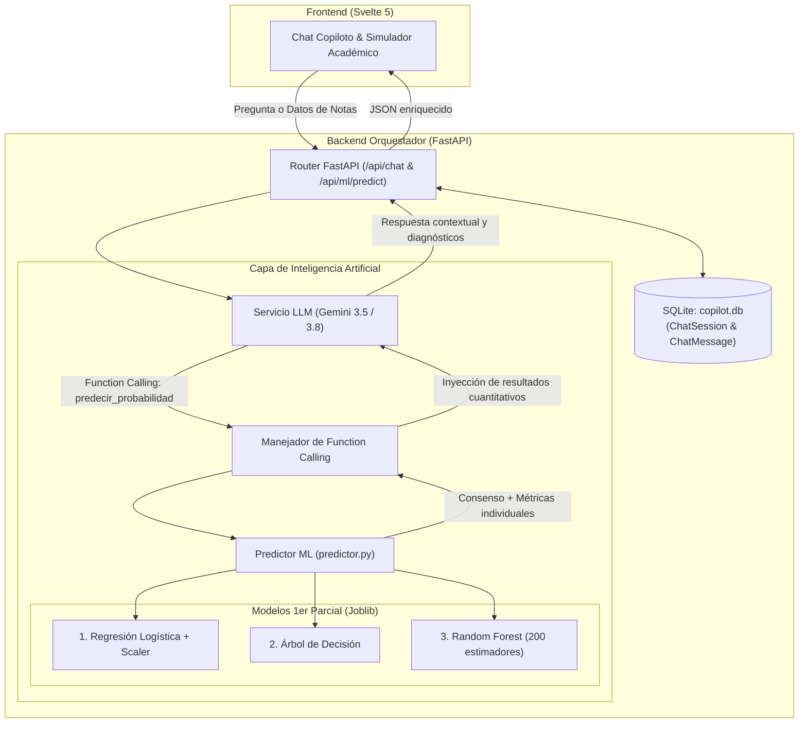
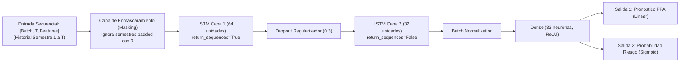

# 🧠 Guía de Inducción Técnica: Inteligencia Artificial y Propuesta LSTM
> **Proyecto:** Sistema Inteligente de Acompañamiento y Diagnóstico Académico (Copiloto FIUNA)  
> **Cátedra:** Inteligencia Artificial (2C 2026) — Facultad de Ingeniería, Universidad Nacional de Asunción (FIUNA)  
> **Profesor Titular:** Dr. Diego Stalder | **Auxiliar de Práctica:** Ing. Enrique Paiva  
> **Destinatario:** Nuevos integrantes del equipo de desarrollo e investigación  

---

## 📌 Tabla de Contenidos
1. [Resumen Ejecutivo y Contexto del Proyecto](#1-resumen-ejecutivo-y-contexto-del-proyecto)
2. [Alineación con el Plan de Clases de la Cátedra](#2-alineación-con-el-plan-de-clases-de-la-cátedra)
3. [Arquitectura de IA Implementada en el Proyecto](#3-arquitectura-de-ia-implementada-en-el-proyecto)
   - 3.1. [Pipeline de Machine Learning Clásico (1er Parcial)](#31-pipeline-de-machine-learning-clásico-1er-parcial)
   - 3.2. [Agente Inteligente con LLM y Function Calling](#32-agente-inteligente-con-llm-y-function-calling)
   - 3.3. [Persistencia y Memoria Contextual](#33-persistencia-y-memoria-contextual)
4. [Propuesta de Implementación de Redes LSTM](#4-propuesta-de-implementación-de-redes-lstm)
   - 4.1. [¿Por qué una LSTM? (Justificación Teórica y Práctica)](#41-por-qué-una-lstm-justificación-teórica-y-práctica)
   - 4.2. [Formulación del Problema Temporal](#42-formulación-del-problema-temporal)
   - 4.3. [Arquitectura de la Red Propuesta](#43-arquitectura-de-la-red-propuesta)
   - 4.4. [Código de Referencia (PyTorch / TensorFlow)](#44-código-de-referencia-pytorch--tensorflow)
   - 4.5. [Plan de Integración al Backend y Frontend Existente](#45-plan-de-integración-al-backend-y-frontend-existente)
5. [Guía Rápida para el Nuevo Desarrollador](#5-guía-rápida-para-el-nuevo-desarrollador)

---

## 1. Resumen Ejecutivo y Contexto del Proyecto

El **Sistema Inteligente de Acompañamiento y Diagnóstico Académico (Copiloto FIUNA)** es una solución tecnológica integral diseñada para abordar uno de los problemas históricos más críticos de la Facultad de Ingeniería de la UNA: **la alta tasa de recursamiento, retención y deserción en asignaturas troncales y filtro** (tales como *Estática*, *Cálculo*, *Física*, entre otras).

### El problema académico
Al promediar el semestre, tras la publicación de las notas del 2° Parcial y Trabajos Prácticos/Laboratorio, los estudiantes deben tomar decisiones críticas bajo alta incertidumbre:
- ¿Conviene dedicar tiempo a preparar el examen final de una materia filtro o priorizar materias con mayor probabilidad de aprobación?
- ¿Cuál es la probabilidad matemática y estadística real de aprobar la materia dada la firma actual?
- ¿Cómo gestionar la carga académica para evitar la deserción o el bloqueo de correlatividades en la malla curricular?

### La solución del proyecto
El sistema combina:
1. **Modelos Predictivos Supervisados de Machine Learning**: Entrenados con registros académicos históricos reales de la FIUNA para estimar con rigor cuantitativo la probabilidad de aprobación.
2. **Un Agente Conversacional Inteligente (LLM Orquestado)**: Con capacidad de *Function Calling*, memoria persistente de sesión y acceso al perfil académico del estudiante mediante integración institucional.
3. **Plataforma Web Reactiva y Desacoplada**: Desarrollada en **Svelte 5** (Frontend) y **FastAPI** (Backend orquestador en Python), garantizando seguridad, modularidad y alta velocidad.

---

## 2. Alineación con el Plan de Clases de la Cátedra

El proyecto fue concebido siguiendo estrictamente el cronograma de 24 clases efectivas y los 6 Trabajos Prácticos (TPs) paralelos fijados por la cátedra en el archivo [planIA2026-2.pdf](file:///C:/Users/Andre/Documents/Fiuna/optativa/IA/Antigraviti/prouebaSvelte/defensa_ignorar_github/planIA2026-2.pdf):

| Hito / Semanas | Temas del Plan de Clases | Implementación en Nuestro Proyecto |
| :--- | :--- | :--- |
| **Semanas 1–4 (Clases 1–8)**<br>`TP1: Repo + EDA` | Pipeline de IA, Preprocesamiento (imputación, outliers, encoding), Train/Test Split, Regresión Logística, Árboles de Decisión, Regularización y Métricas (Accuracy, Precision, Recall, F1, ROC-AUC). | • Estructuración del repositorio y control de versiones.<br>• EDA sobre `datos_concatenados.csv` (10 MB de registros FIUNA).<br>• Limpieza y tratamiento del desbalanceo de clases (`class_weight='balanced'`). |
| **Semanas 5–7 (Clases 9–14)**<br>`TP2: Baseline + Clásicos`<br>`TP3: Docs & Repaso` | SVM, Ensambles (Random Forest), Redes Neuronales (MLP, Backpropagation), hiperparámetros. Primer Parcial de la cátedra. | • Desarrollo y validación cruzada en el notebook `PrimerParcialIA2026.ipynb`.<br>• Serialización con `joblib` de: Regresión Logística, Árbol de Decisión y Random Forest.<br>• Creación del microservicio `trainer.py` y `predictor.py`. |
| **Semanas 10–12 (Clases 15–20)**<br>`TP4: Transfer / Modelos`<br>`TP5: Despliegue API` | CNNs, Series Temporales (ARIMA, XGBoost, GRU), Despliegue con FastAPI, GitHub Pages, Vercel. | • Creación del backend modular en **FastAPI** (`backend/main.py`).<br>• Arquitectura de persistencia local en SQLite (`copilot.db`).<br>• Endpoints REST para inferencia `/api/ml/predict` y modelos `/api/ml/models`. |
| **Semanas 13–14 (Clases 21–24)**<br>`TP6: RAG + Agentes` | NLP, Transformers, Modelos Fundacionales (LLMs), RAG, Agentes Inteligentes (ReAct, Function Calling). | • Agente de IA institucional impulsado por **Google Gemini** con prompt engineering especializado.<br>• Implementación de **Function Calling** bidireccional entre el LLM y los modelos locales de ML.<br>• Historial conversacional multiturno persistido. |
| **Semanas 15–16 (Clases 25–28)**<br>`Cierre y Defensa` | Pitch del proyecto, ensayos, pulido final y defensa ante el tribunal de evaluación. | • Documentación integral, pruebas end-to-end e integración de la extensión para análisis secuencial (**LSTM**). |

---

## 3. Arquitectura de IA Implementada en el Proyecto

El siguiente diagrama ilustra el flujo de datos e inferencia del sistema actual:



### 3.1. Pipeline de Machine Learning Clásico (1er Parcial)

El núcleo predictivo del 1er Parcial fue desarrollado y contrastado empíricamente en el notebook `PrimerParcialIA2026.ipynb` y empaquetado en `backend/services/ml/`:

1. **Variables de Entrada ($X$):**
   - `Primer.Par`: Calificación del 1er Examen Parcial (0 a 100).
   - `Segundo.Par`: Calificación del 2do Examen Parcial (0 a 100).
   - `TPLab.`: Calificación del Trabajo Práctico / Laboratorio / Taller (0 a 100).
2. **Variable Objetivo ($y$):**
   - `Aprobado`: Variable binaria codificada como $1$ (Aprobó la asignatura) o $0$ (No aprobó / recursó).
3. **Tratamiento del Dataset:**
   - Tratamiento de datos nulos y valores fuera de escala.
   - Partición estratificada: 70% entrenamiento (`train`) y 30% evaluación (`test`), manteniendo la proporción real de aprobados (~29% en asignaturas como Estática).
4. **Modelos en Producción:**
   - **Regresión Logística:** Modelo probabilístico lineal base. Requiere `StandardScaler`. Configurado con regularización $L_2$ y pesos ponderados (`class_weight='balanced'`) para mitigar el sesgo hacia la clase mayoritaria (reprobados).
   - **Árbol de Decisión:** Modelo no lineal basado en particiones ortogonales en el espacio de características (`max_depth=6`, `min_samples_leaf=10`, criterio de impureza Gini).
   - **Random Forest:** Ensamble de 200 árboles de decisión con *bootstrap aggregating* y selección aleatoria de atributos, logrando un balance óptimo entre sesgo y varianza.

#### Métricas de Referencia Obtenidas (Asignatura: Estática)
| Modelo | Accuracy | AUC-ROC | Precision | Recall | F1-Score |
| :--- | :---: | :---: | :---: | :---: | :---: |
| **Regresión Logística** | 82.22% | 0.9319 | 62.98% | **94.27%** | 0.7551 |
| **Árbol de Decisión** | 85.74% | 0.9399 | 70.41% | 87.90% | 0.7819 |
| **Random Forest** | **86.85%** | **0.9523** | **70.87%** | 92.99% | **0.8044** |

> **Nota para la defensa:** Destacar el alto valor de **Recall** (>92% en Random Forest y >94% en Regresión Logística). En el contexto académico de FIUNA, un falso positivo (decirle al alumno que aprobará cuando en realidad va a reprobar) es mucho más dañino que un falso negativo, por lo que maximizar la sensibilidad del modelo fue una decisión metodológica deliberada.

---

### 3.2. Agente Inteligente con LLM y Function Calling

Ubicación del código: [`backend/services/llm.py`](file:///C:/Users/Andre/Documents/Fiuna/optativa/IA/Antigraviti/prouebaSvelte/backend/services/llm.py).

En lugar de un chatbot genérico que alucina respuestas o inventa probabilidades, el proyecto implementa un **agente gobernado**:
1. **Detección de Intención e Invocación de Herramientas**:
   Se define mediante el esquema OpenAPI la tool:
   ```json
   {
     "name": "predecir_probabilidad_aprobacion",
     "description": "Ejecuta la inferencia de los 3 modelos de ML para predecir si el alumno aprueba...",
     "parameters": {
       "properties": {
         "materia": {"type": "STRING"},
         "primer_parcial": {"type": "NUMBER"},
         "segundo_parcial": {"type": "NUMBER"},
         "tplab": {"type": "NUMBER"}
       },
       "required": ["primer_parcial", "segundo_parcial", "tplab"]
     }
   }
   ```
2. **Ciclo de Ejecución (Function Calling Protocol)**:
   - Cuando el usuario formula preguntas como: *"Tengo 62 en el primer parcial, 70 en el segundo y 80 en el TP de Estática, ¿qué chances tengo de pasar?"*, el LLM no genera una cifra al azar; responde con una solicitud de llamada a función (`function_call`).
   - El backend intercepta esta llamada, invoca [`predecir_aprobacion()`](file:///C:/Users/Andre/Documents/Fiuna/optativa/IA/Antigraviti/prouebaSvelte/backend/services/ml/predictor.py#L125), que carga los `.joblib`, ejecuta la inferencia con los 3 modelos y calcula el consenso ponderado.
   - Los resultados numéricos precisos regresan al LLM en el turno de respuesta de herramienta (`function_response`).
   - Finalmente, el LLM redacta un informe cualitativo empático, indicando los porcentajes exactos de cada modelo, el consenso y consejos pedagógicos concretos para el examen final.

### 3.3. Persistencia y Memoria Contextual
- Implementada con **SQLAlchemy** sobre SQLite (`backend/copilot.db`).
- Las tablas [`ChatSession`](file:///C:/Users/Andre/Documents/Fiuna/optativa/IA/Antigraviti/prouebaSvelte/backend/models.py) y [`ChatMessage`](file:///C:/Users/Andre/Documents/Fiuna/optativa/IA/Antigraviti/prouebaSvelte/backend/models.py) almacenan el historial completo de cada conversación indexado por `session_id`.
- Cuando el estudiante continúa una conversación de hace días o cambia de pestaña, el backend reconstruye el hilo de memoria contextual antes de consultar a Gemini, permitiendo referencias anafóricas (ej. *"¿Y si en el segundo parcial hubiera sacado 10 puntos menos?"*).

---

## 4. Propuesta de Implementación de Redes LSTM

Esta sección detalla cómo extender el proyecto integrando **Redes Neuronales Recurrentes del tipo LSTM (Long Short-Term Memory)**, conectando de forma directa con los contenidos de las **Clases 17 y 18 del Plan de Clases (Series Temporales y Redes Recurrentes)**.

### 4.1. ¿Por qué una LSTM? (Justificación Teórica y Práctica)

#### La limitación del enfoque actual
Los modelos de clasificación actuales (Regresión Logística, Árboles, Random Forest) son de naturaleza **tabular estática**: reciben un único vector $[P_1, P_2, TP] \in \mathbb{R}^3$ correspondiente a una única materia en un momento puntual.

#### La realidad del estudiante de ingeniería
La trayectoria de un estudiante en la FIUNA **no es estática; es un proceso estocástico secuencial dependiente del tiempo**.
1. **Inercia académica (Memoria de Largo Plazo)**: El rendimiento de un alumno en semestres avanzados (ej. 5to semestre) está fuertemente condicionado por la solidez y el ritmo de aprobación demostrado en los semestres anteriores (1ro al 4to).
2. **Dependencias temporales no lineales**: El agotamiento académico, la acumulación de materias pendientes, la cantidad de créditos inscritos simultáneamente y la varianza de notas a lo largo de los periodos lectivos configuran una serie temporal multivariada.
3. **Ventaja matemática de la LSTM**: A diferencia de una RNN simple que sufre el problema de desvanecimiento o explosión del gradiente (*vanishing/exploding gradient*), la celda LSTM incorpora compuertas especializadas:
   - **Compuerta de Olvido ($f_t$):** Decide qué información descartar del estado anterior.
   - **Compuerta de Entrada ($i_t$):** Decide qué nuevos valores actualizar en el estado de la celda.
   - **Estado de Celda ($C_t$):** Canal de memoria persistente a largo plazo.
   - **Compuerta de Salida ($o_t$):** Determina el estado oculto $h_t$ emitido en cada paso de tiempo.

$$\begin{aligned}
f_t &= \sigma(W_f \cdot [h_{t-1}, x_t] + b_f) \\
i_t &= \sigma(W_i \cdot [h_{t-1}, x_t] + b_i) \\
\tilde{C}_t &= \tanh(W_c \cdot [h_{t-1}, x_t] + b_c) \\
C_t &= f_t * C_{t-1} + i_t * \tilde{C}_t \\
o_t &= \sigma(W_o \cdot [h_{t-1}, x_t] + b_o) \\
h_t &= o_t * \tanh(C_t)
\end{aligned}$$

---

### 4.2. Formulación del Problema Temporal

Definimos la trayectoria de un estudiante como una secuencia de $T$ periodos académicos (semestres cursados):

$$X = [x_1, x_2, \dots, x_T] \in \mathbb{R}^{T \times D}$$

Donde en cada semestre $t \in \{1, \dots, T\}$, el vector de características $x_t \in \mathbb{R}^D$ contiene:
1. `PPA_semestre`: Promedio Ponderado Acumulado obtenido en el semestre $t$.
2. `creditos_inscritos`: Cantidad de créditos intentados.
3. `creditos_aprobados`: Cantidad de créditos efectivamente superados.
4. `tasa_exito_semestral`: $\frac{\text{créditos aprobados}}{\text{créditos inscritos}}$.
5. `materias_reprobadas`: Número de aplazos o materias recursadas en el ciclo.
6. `rendimiento_materias_clave`: Promedio normalizado en las materias troncales del ciclo.

#### Objetivos Predictivos de la LSTM:
- **Tarea 1 (Clasificación Secuencial - Alerta Temprana):** Predecir si el estudiante caerá en riesgo crítico de abandono o retraso severo en el semestre $T+1$ ($y \in \{0, 1\}$).
- **Tarea 2 (Regresión Secuencial / Forecasting):** Predecir el PPA proyectado y la cantidad de créditos que el alumno logrará aprobar en el siguiente semestre ($y \in \mathbb{R}^2$), permitiendo sugerir cuántas asignaturas inscribir.

---

### 4.3. Arquitectura de la Red Propuesta



---

### 4.4. Código de Referencia (PyTorch / TensorFlow)

A continuación se presenta el código funcional listo para ser integrado en `backend/services/ml/lstm_model.py`:

```python
"""
lstm_model.py
Modelo LSTM para predicción de riesgo académico y proyección de rendimiento temporal en FIUNA.
Compatible con TensorFlow/Keras 2.x / 3.x.
"""

import tensorflow as tf
from tensorflow.keras import layers, models, optimizers

def construir_modelo_lstm(timesteps: int = 10, num_features: int = 6) -> tf.keras.Model:
    """
    Construye una red LSTM bidireccional / apilada con dos cabezas de salida:
    1. Salida de Regresión: Estimación del PPA próximo semestre.
    2. Salida de Clasificación: Probabilidad de estar en estado de rezago crítico.
    """
    entradas = layers.Input(shape=(timesteps, num_features), name="historial_semestral")
    
    # Enmascaramiento para manejar estudiantes con diferente cantidad de semestres cursados
    x = layers.Masking(mask_value=0.0)(entradas)
    
    # Primera capa LSTM con retorno de secuencias
    x = layers.LSTM(64, return_sequences=True, dropout=0.2, recurrent_dropout=0.1)(x)
    x = layers.BatchNormalization()(x)
    
    # Segunda capa LSTM que condensa la información temporal
    x = layers.LSTM(32, return_sequences=False, dropout=0.2)(x)
    x = layers.BatchNormalization()(x)
    
    # Capa densa intermedia compartida
    compartida = layers.Dense(32, activation="relu")(x)
    compartida = layers.Dropout(0.3)(compartida)
    
    # Cabeza 1: Proyección de PPA (Regresión lineal)
    salida_ppa = layers.Dense(1, activation="linear", name="prediccion_ppa")(compartida)
    
    # Cabeza 2: Probabilidad de Riesgo Académico (Clasificación Sigmoide)
    salida_riesgo = layers.Dense(1, activation="sigmoid", name="probabilidad_riesgo")(compartida)
    
    modelo = models.Model(
        inputs=entradas,
        outputs=[salida_ppa, salida_riesgo],
        name="LSTM_Copiloto_FIUNA"
    )
    
    modelo.compile(
        optimizer=optimizers.Adam(learning_rate=0.001),
        loss={
            "prediccion_ppa": "mse",
            "probabilidad_riesgo": "binary_crossentropy"
        },
        metrics={
            "prediccion_ppa": ["mae"],
            "probabilidad_riesgo": ["accuracy", tf.keras.metrics.AUC(name="auc")]
        }
    )
    
    return modelo


if __name__ == "__main__":
    modelo = construir_modelo_lstm(timesteps=8, num_features=6)
    modelo.summary()
```

---

### 4.5. Plan de Integración al Backend y Frontend Existente

Para que el nuevo compañero pueda ejecutar e integrar la LSTM con la arquitectura actual, se definen 4 pasos concisos:

1. **Creación del Servicio de Inferencia en Backend:**
   - Crear el archivo `backend/services/ml/lstm_service.py`.
   - Cargar el modelo preentrenado guardado en `backend/services/ml/saved_models/lstm_trayectoria.keras`.
   - Normalizar la matriz de historial de semestres del alumno con `joblib.load('lstm_scaler.joblib')`.

2. **Nuevo Endpoint en FastAPI (`backend/main.py`):**
   ```python
   @app.post("/api/ml/predict-trajectory", response_model=TrajectoryPredictResponse, tags=["Machine Learning"])
   async def predict_trajectory(request: TrajectoryPredictRequest):
       # Recibe la lista de semestres previos del alumno y ejecuta la inferencia de la LSTM
       return lstm_service.evaluar_trayectoria(request.semestres)
   ```

3. **Integración al Agente Conversacional (`backend/services/llm.py`):**
   - Añadir una nueva función a `ML_TOOLS_DECLARATION`: `analizar_trayectoria_temporal_estudiante`.
   - Cuando el alumno consulte: *"Vengo de recursar dos materias en el 3er semestre y levanté mis notas en el 4to, ¿me conviene meter 6 materias ahora?"*, Gemini invocará la LSTM y analizará la inercia temporal para formular una respuesta hiper-personalizada.

4. **Visualización en Svelte 5 (`mi-app-svelte`):**
   - Añadir un componente `TrajectoryChart.svelte` usando Chart.js o Canvas interactivo, mostrando la curva histórica de PPA y la proyección punteada futura con intervalos de confianza calculados por la LSTM.

---

## 5. Guía Rápida para el Nuevo Desarrollador

### Entorno y Ejecución Local

1. **Instalar dependencias del Backend:**
   ```bash
   cd prouebaSvelte
   uv sync
   # O con virtualenv estándar:
   .\.venv\Scripts\activate
   pip install -r requirements.txt
   ```

2. **Ejecutar el Servidor Backend:**
   ```bash
   uv run uvicorn backend.main:app --reload --port 8000
   ```
   - Swagger / Documentación interactiva de APIs: `http://localhost:8000/docs`

3. **Ejecutar la Aplicación Web (Frontend):**
   ```bash
   cd mi-app-svelte
   npm install
   npm run dev
   ```
   - Aplicación Frontend: `http://localhost:5173`

4. **Variables de Entorno (`backend/.env`):**
   ```env
   GEMINI_API_KEY=tu_api_key_de_google_ai_studio
   DATABASE_URL=sqlite:///./copilot.db
   ```

---
*Documento elaborado para el equipo de desarrollo de IA - Cátedra de Inteligencia Artificial FIUNA 2026.*
